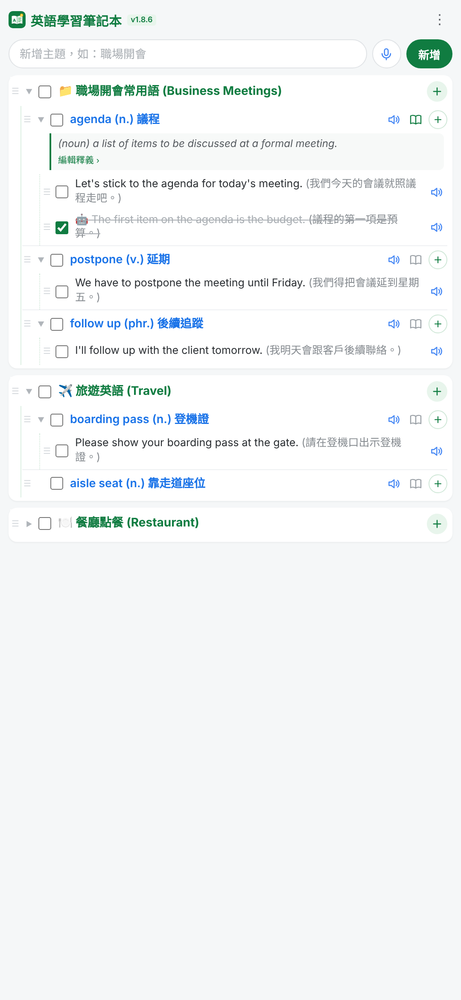

# 📖 英語學習筆記本

一個可以安裝在 Android 手機上的英語單字／例句筆記本。
輸入單字後，AI 會自動補上英文釋義和中英對照例句；還能用真人般的 AI 語音連續播放例句（關閉螢幕也能聽），以及用克漏字題目自我測驗。

**👉 立即使用：<https://chahan1.github.io/>**

---

## ✨ 主要功能

### 📝 三層筆記結構
| 層級 | 用途 | 範例 |
|---|---|---|
| 主題 | 一組單字的分類 | 📁 職場開會常用語 |
| 單字／片語 | 要學的單字 | agenda (n.) 議程 |
| 例句 | 單字的用法 | Let's stick to the agenda. (我們照議程走吧。) |

- 拖曳左側 ☰ 可以調整順序，也可以把單字或例句拖到別的主題下。
- 勾選方塊表示「已熟記」，可在選單中隱藏已熟記的項目。

### 🤖 AI 自動查詢（Groq／Free.ai／Gemini）
- 新增單字後，AI 自動產生**英文釋義（含詞性）**與**一句中英對照例句**。
- 支援三家 AI，依序使用 **Groq → Free.ai → Gemini**，一家失敗或額度用完就自動換下一家。
- 按單字右邊的 **＋**，可以選擇「**AI 再產生一句例句**」（與現有例句情境不同）或「自己輸入例句」。
- 「🎨 AI 例句風格」可統一設定例句的**風格**（一般／生活口語／多益題型）與**程度**（中級 B1／中高級 B2）。
- **離線也能新增單字**：先標示為「待補齊」，一連上網路就自動補上釋義與例句。
- 點一下釋義內容即可手動修改。

### 🎤 語音輸入與 🔊 朗讀
- 用麥克風說出主題或單字，自動轉成文字。
- 每個單字和例句旁都有 🔊，可聽發音（朗讀時只念英文，會略過中文翻譯）。

### ▶️ 例句連續播放
按左下角的 **▶** 開啟播放設定：

| 設定 | 選項 |
|---|---|
| 語音 | **免費 AI 語音**（Free.ai）／Gemini 語音（可能收費）／手機語音（離線） |
| 聲音 | Free.ai 7 種、Gemini 8 種，可先試聽 |
| 範圍 | 全部例句／只播已熟記／只播未熟記 |
| 日期 | 全部日期／今天／最近 7 天／指定日期 |
| 順序 | 依序播放／🔀 隨機播放（10、20、30 句或全部） |
| 每句念幾次 | 1～10 次 |
| 句子間隔 | 0.5～15 秒，每念完一次就停頓（含同一句的重複，適合跟讀練習） |
| 語速 | 慢／正常／快 |

- 播放時下方會跳出播放視窗，顯示正在念的例句、進度與控制按鈕。
- **AI 語音（Free.ai 或 Gemini）可以關閉螢幕繼續播放**，鎖定畫面也有播放控制。
- AI 語音每句只產生一次並存在手機裡，之後重播不再花費，離線也能播放。

### ✍️ 克漏字練習
按左下角的 **✍️**（或選單中的「克漏字練習」）：
- 從例句中**隨機出題**，自動把單字挖空（能辨識 postpone → postponed 這類變化形）。
- 三種難度：**初級**（挖一個字）／**中級**（挖整個片語，例如 stick to）／**高級**（同一句挖 2～3 個空格，全部答對才算對）。
- 可選範圍、日期與題數（10／20／30／全部）。
- 作答輔助：💡 提示字母、中 顯示中文、🔊 聽句子。
- 不分大小寫；拼錯一個字母也算對，但會顯示正確拼法。
- 結束後顯示成績，可**一鍵把答對的例句標為已熟記**，或**只重練答錯的題目**。

### 📊 學習紀錄與複習報表
- 每句例句旁會顯示小標籤：**▶ 12**（被播放的次數）、**✍️ 3/4**（克漏字答對／作答次數）。連續播放、按 🔊、克漏字的「聽句子」都會計入。
- 選單「📊 複習報表」可以看到：
  - 例句總數、已熟記比例、總播放次數、克漏字正確率
  - 最近 14 天每天的播放次數與克漏字題數
  - 例句清單，可依「最少播放／最多播放／最常答錯／最久沒複習」排序，並一鍵「**▶ 播放這些**」或「**✍️ 練習這些**」
- 每句的播放次數與克漏字成績會一起存進備份檔（14 天每日統計不包含在內）。

### 👀 顯示設定（右上角 ⋮ 選單）
- 📖 顯示／隱藏全部釋義
- 📝 顯示／隱藏全部例句（只看單字清單，方便自我測驗）
- 💬 顯示／隱藏例句中文（預設隱藏）
- 🕒 顯示建立／熟記時間
- ⚙️ 開啟修改模式（顯示編輯 ✏️ 與刪除 🗑️ 按鈕）

### 💾 備份與還原
- 「📥 下載備份檔」：所有筆記存成一個 `.json` 檔，放在手機的「下載」資料夾。
- 「📂 從備份檔還原」：換手機、重新安裝時用來找回筆記。
- 超過 7 天沒備份，畫面上方會出現提醒。

---

## 📱 安裝到 Android 手機

**方法一：加到主畫面（最簡單）**
1. 用手機的 **Chrome** 開啟 <https://chahan1.github.io/>
2. 點右上角 ⋮ →「加到主畫面」

**方法二：安裝 APK**
1. 到 [PWABuilder](https://www.pwabuilder.com) 輸入 `https://chahan1.github.io/`
2. 選 Android → 產生安裝檔，下載後安裝到手機
3. `.well-known/assetlinks.json` 已放在本倉庫，App 頂端不會出現網址列

> ⚠️ 安裝後**第一次開啟請連上網路**，程式才會存到手機裡，之後就能離線開啟。

---

## 🔑 設定 AI 金鑰

開啟 App → 右上角 ⋮ →「🔑 AI 金鑰設定」，至少填一組，每一組都可以按「測試」確認能否使用：

| 服務 | 用途 | 免費額度（2026 年 11 月） | 申請 |
|---|---|---|---|
| **Groq** | 查單字、產生例句（首選） | 每天約 1,000 次，不需信用卡 | <https://console.groq.com/keys> |
| **Free.ai** | **免費 AI 語音**＋查單字 | 每天 30,000 tokens、每月 1,000 次 API 請求 | <https://free.ai>（需驗證 Email） |
| **Gemini** | 查單字＋AI 語音 | 視帳號而定，語音可能收費 | <https://aistudio.google.com/apikey> |

- 金鑰只存在你自己的手機裡，不會出現在這個 GitHub 倉庫。
- 學校的 Google Workspace 帳號可能無法使用 Gemini 免費額度，建議用個人帳號或改用 Groq／Free.ai。
- 免費方案的額度與規則可能變動；免費服務通常會用輸入內容改進模型，請勿輸入個人隱私資料。

---

## 🔒 資料與隱私

- **筆記存在你自己的手機（瀏覽器儲存空間）**，不會上傳到 GitHub 或其他伺服器。
- 這個倉庫只放程式檔案，任何人看到的都只是空白的程式。
- 筆記是跟「網址」綁在一起的：換網址、清除 App 資料或解除安裝，筆記都會不見，**請定期下載備份檔**。
- AI 產生的語音存在手機裡，不包含在備份檔中，需要時重新產生即可。

---

## 📂 檔案說明

| 檔案 | 說明 |
|---|---|
| `index.html` | 主程式（所有功能與畫面） |
| `sw.js` | Service Worker：讓 App 可以離線開啟，並負責版本更新 |
| `manifest.json` | App 設定（名稱、圖示、主題色） |
| `icon-192.png`、`icon-512.png` | App 圖示 |
| `maskable-192.png`、`maskable-512.png` | Android 圓形裁切用圖示 |
| `apple-touch-icon.png` | iPhone 主畫面圖示 |
| `screenshot-1.png` | App 畫面截圖（商店展示用） |
| `.nojekyll` | 讓 GitHub Pages 不要略過 `.well-known` 資料夾 |
| `.well-known/assetlinks.json` | Android App 與網站的驗證配對檔 |

---

## 🔄 更新程式

1. 把新版的所有檔案拖進本倉庫（**Add file → Upload files**），按 **Commit changes**
2. 等 1～2 分鐘讓 GitHub Pages 更新
3. 手機連上網路，開啟 App 一兩次，左上角版本號變成新版即完成

> 每次更新時，`sw.js` 第 3 行的版本號（`CACHE_NAME`）都要改，手機才會知道有新版。
> **APK 不需要重新產生**，App 會自動顯示新版內容。

---

## ❓ 常見問題

**Q：AI 查詢失敗，出現「free tier is not available for this project」？**
這個 Google 專案不符合免費額度資格（學校帳號常見）。可以改填 Groq 或 Free.ai 金鑰（免費），或用個人 Gmail 帳號建立新的 Gemini 金鑰。

**Q：金鑰測試顯示「無法連線（此服務可能不允許網頁直接連線）」？**
代表這家服務不接受從網頁直接呼叫，請改用其他家的金鑰。

**Q：關閉螢幕後播放就停了？**
請在播放設定中選「**免費 AI 語音**」或「**Gemini 語音**」。手機語音（系統朗讀）在關閉螢幕後會被 Android 暫停，這是瀏覽器的限制。若仍會停止，可到「設定 → 應用程式 → 本 App → 電池」改為「不限制」。

**Q：手機語音聽起來很機械？**
到手機「設定」搜尋「文字轉語音」，把偏好引擎改為 **Google 語音服務**，並下載「English (United States)」語音資料；或直接改用「免費 AI 語音」。

**Q：語音輸入沒有反應？**
請用 Chrome 開啟（不要在 LINE、Facebook 內建瀏覽器開啟），並允許麥克風權限。語音辨識需要網路。

**Q：上傳新版後手機還是舊版？**
確認 `index.html` 和 `sw.js` 都有上傳，再連網開啟 App 一兩次。

---

## 📜 版本紀錄

| 版本 | 更新內容 |
|---|---|
| v1.9.9 | 例句播放次數與克漏字成績紀錄、複習報表；克漏字難度（初／中／高級）；AI 例句風格與程度設定 |
| v1.9.8 | 新增 Groq、Free.ai（含免費 AI 語音），AI 金鑰設定畫面與測試按鈕 |
| v1.9.7 | 句子間隔也套用在同一句的重複之間 |
| v1.9.6 | 例句播放可設定句子間隔；新增克漏字練習 |
| v1.9.5 | 單字下可由 AI 再產生例句；隨機播放（10／20／30 句） |
| v1.9.4 | AI 真人語音播放，關閉螢幕也能繼續聽 |
| v1.9.3 | 播放視窗、按日期播放、播完可從頭再播、左下角播放鍵 |
| v1.9.2 | 例句連續播放（範圍、次數、語速） |
| v1.9.1 | 釋義與例句改為選單統一顯示／隱藏；加寬單字欄位 |
| v1.9.0 | 例句中文翻譯由選單統一開關 |
| v1.8.7 | 離線新增的單字，上線後 AI 自動補齊 |
| v1.8.6 | 修正 PWABuilder 圖示錯誤，加入商店截圖 |
| v1.8.5 | 一鍵下載備份檔、7 天備份提醒 |
| v1.8.3～1.8.4 | 手機版畫面精簡、改用線條圖示 |
| v1.8.2 | 支援 PWA 安裝與離線開啟 |
| v1.8.1 | 修正 Gemini 模型失效、拖曳後例句消失等問題 |

---

## 🛠 技術說明

- 純 HTML／CSS／JavaScript 單一檔案，不需要建置工具
- 資料儲存：`localStorage`（筆記、學習紀錄）、`IndexedDB`（AI 語音快取）
- AI：Groq、Free.ai、Google Gemini（文字生成）；Free.ai Kokoro、Gemini TTS（語音）
- 語音：Web Speech API（語音辨識、系統朗讀）
- 拖曳排序：[SortableJS](https://github.com/SortableJS/Sortable)
- 部署：GitHub Pages；Android 安裝檔由 PWABuilder（Trusted Web Activity）產生
